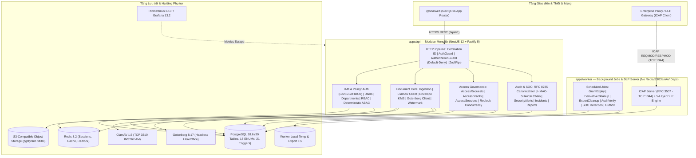
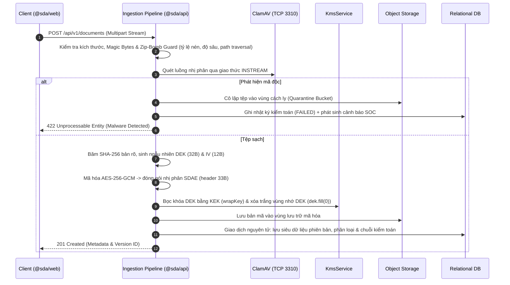

# Secure Document Access System (SDA)

Nền tảng quản trị, lưu trữ mã hóa và kiểm soát truy cập tài liệu mật theo kiến trúc **Zero Trust**, kết hợp phân quyền **RBAC + Deterministic ABAC**, mô hình đa mức **Bell-LaPadula**, mã hóa phong bì **AES-256-GCM**, thủy ấn pháp chứng động (**Forensic Watermarking**), chuỗi nhật ký bất biến **RFC 8785 + HMAC-SHA256** và cổng chống thất thoát dữ liệu tầng mạng **ICAP Server (RFC 3507)**.

---

## Mục lục

1. [Tổng quan Công nghệ (Tech Stack)](#1-tổng-quan-công-nghệ-tech-stack)
2. [Kiến trúc Hệ thống & Monorepo](#2-kiến-trúc-hệ-thống--monorepo)
3. [Luồng Xử lý Dữ liệu Trọng yếu](#3-luồng-xử-lý-dữ-liệu-trọng-yếu)
4. [Đặc tả Cơ chế Bảo mật & Mật mã học](#4-đặc-tả-cơ-chế-bảo-mật--mật-mã-học)
5. [Mô hình Phân quyền, Phân loại Mật & Toàn vẹn Lưu trữ](#5-mô-hình-phân-quyền-phân-loại-mật--toàn-vẹn-lưu-trữ)
6. [Cài đặt & Vận hành Môi trường Phát triển](#6-cài-đặt--vận-hành-môi-trường-phát-triển)
7. [Tham chiếu Biến Môi trường](#7-tham-chiếu-biến-môi-trường)
8. [Kiểm thử, Cổng Chất lượng & DevSecOps](#8-kiểm-thử-cổng-chất-lượng--devsecops)
9. [Triển khai Production & Cứng hóa Container](#9-triển-khai-production--cứng-hóa-container)
10. [Tài liệu Tham khảo Nội bộ](#10-tài-liệu-tham-khảo-nội-bộ)

---

## 1. Tổng quan Công nghệ (Tech Stack)

| Phân tầng               | Công nghệ & Phiên bản                                                                                      | Vai trò Kỹ thuật                                                                                       |
| :---------------------- | :--------------------------------------------------------------------------------------------------------- | :----------------------------------------------------------------------------------------------------- |
| **Runtime & Build**     | Node.js `>=24.14.0 <25` (ESM), TypeScript `7.0`, `pnpm@12.4.1`, Turborepo `2.10`                           | Quản lý workspace monorepo, kiểm tra kiểu dữ liệu nghiêm ngặt, điều phối build theo đồ thị phụ thuộc   |
| **Backend API**         | NestJS `12.3`, Fastify `5.12`, Zod `4.6`, Swagger / OpenAPI                                                | Modular Monolith REST API (`/api/v1`), validation đầu vào nghiêm ngặt, Policy Decision/Enforcement     |
| **Frontend Web**        | Next.js `16.4` (App Router), React `19.3`, Tailwind CSS `4.3`, `lucide-react`                              | 5 không gian làm việc biệt lập theo vai trò, trình dựng chính sách ABAC (DNF AST), xem tài liệu        |
| **Background & DLP**    | Node.js Worker (`@sda/worker`), Native TCP Server (`RFC 3507`)                                             | 6 tiến trình nền định kỳ + máy chủ ICAP Network DLP lắng nghe cổng TCP `1344`                          |
| **Cơ sở dữ liệu**       | PostgreSQL `18.6`, Prisma ORM `7.10` (`@prisma/adapter-pg`), PGlite `0.5` (WASM)                           | Lưu trữ dữ liệu quan hệ, giao dịch cô lập `SERIALIZABLE`, ràng buộc toàn vẹn cấp CSDL, kiểm thử cô lập |
| **Bộ nhớ đệm & Khóa**   | Redis `8.2`, `ioredis` `6.0`, Custom Redlock + Lua Scripts                                                 | Lưu trữ phiên, bộ đệm quyền/chính sách, giới hạn tần suất (Rate Limit), khóa phân tán Quorum           |
| **Lưu trữ & Xử lý Tệp** | S3-Compatible Object Storage (`pgsty/silo` local, `@aws-sdk/client-s3`), ClamAV `1.5`, Gotenberg `8.17`    | Lưu trữ đối tượng mã hóa, quét mã độc luồng TCP `INSTREAM`, chuyển đổi Office sang PDF, đóng dấu       |
| **Mật mã & Xác thực**   | `node:crypto` (`AES-256-GCM`, `HKDF-SHA256`), `jose` (`EdDSA`/`Ed25519`), `argon2`, `@simplewebauthn` `14` | Mã hóa phong bì tài liệu, ký JWT bất đối xứng, băm mật khẩu Argon2id, xác thực TOTP & FIDO2            |
| **Quan sát & Kiểm thử** | Prometheus `3.13`, Grafana `13.2`, Node Test Runner, Playwright `1.63`, Oxlint `1.82`                      | Thu thập metrics, cảnh báo vận hành, kiểm thử Unit / Integration / Infra / E2E                         |

---

## 2. Kiến trúc Hệ thống & Monorepo

Hệ thống được thiết kế theo kiến trúc **Modular Monolith** cho đường đi đồng bộ độ trễ thấp (`@sda/api`) kết hợp tiến trình **Asynchronous Worker & Network DLP Daemon** độc lập (`@sda/worker`).



> **Phân tách Phụ thuộc của `@sda/worker`**: Tiến trình `apps/worker` chỉ phụ thuộc vào `@sda/contracts` và `@sda/database` — kết nối duy nhất tới **PostgreSQL**, hệ thống tệp cục bộ (`os.tmpdir()` cho bản phái sinh tạm thời và `.local/exports` cho tệp xuất báo cáo bất đồng bộ) và mở cổng TCP `1344` cho máy chủ ICAP DLP. Worker **không** cài đặt hay kết nối tới Redis, S3 hay ClamAV.

### Cấu trúc Không gian Làm việc (Workspace Topology)

```text
secure-document-access-system/
├── apps/
│   ├── api/                 # @sda/api — Backend REST API (17 domain modules, Fastify adapter)
│   ├── web/                 # @sda/web — Giao diện người dùng Next.js 16 (5 role workspaces)
│   └── worker/              # @sda/worker — 6 background jobs định kỳ & máy chủ ICAP DLP (TCP 1344)
├── packages/
│   ├── config/              # @sda/config — Cấu hình tsconfig nền tảng dùng chung
│   ├── contracts/           # @sda/contracts — DTOs, Zod schemas, mã lỗi chuẩn hóa, hằng số phân quyền
│   ├── database/            # @sda/database — Prisma 7 multi-file schema (39 bảng), Pool TLS & giao dịch SERIALIZABLE
│   ├── security/            # @sda/security — Helper nguyên thủy kiểm tra metadata public endpoint (isExplicitlyPublicEndpoint)
│   └── testing/             # @sda/testing — Tiện ích kiểm chứng hợp đồng liveness nghiêm ngặt (assertLiveness)
├── infra/                   # Cấu hình Docker Compose (local & hardened prod), Prometheus, Grafana
├── e2e/                     # Kịch bản kiểm thử đầu-cuối (Playwright Chromium)
├── test/                    # Kiểm thử đơn vị cấp kho lưu trữ và kiểm thử sẵn sàng hạ tầng
└── scripts/                 # CLI quản lý hạ tầng/bí mật/kiểm định + 4 bộ mô phỏng PGlite độc lập trên RAM
```

### Danh mục 17 Module Nghiệp vụ trong `@sda/api`

Backend được phân tách thành **17 module nghiệp vụ** độc lập tại `apps/api/src/modules/`:

- **Định danh & Truy cập (5)**: `auth`, `users`, `departments`, `rbac`, `abac`
- **Quản trị Vòng đời Tài liệu (3)**: `documents`, `classifications`, `watermarks`
- **Điều phối Quyền & Tương tranh (4)**: `access-requests`, `access-grants`, `access-sessions`, `concurrency`
- **Kiểm toán, SOC & Vận hành (5)**: `audit`, `security-operations`, `reports`, `notifications`, `system-health`

---

## 3. Luồng Xử lý Dữ liệu Trọng yếu

### 3.1. Pipeline Tiếp nhận & Mã hóa Tài liệu (`DocumentIngestionService`)



### 3.2. Pipeline Đánh giá Chính sách & Phân phối Tài liệu (`DocumentDeliveryService`)

1. **Chặn tại Policy Enforcement Point (`DocumentPepService`)**: Xác thực phiên JWT + kiểm tra trạng thái thu hồi tức thì trên bộ nhớ đệm và CSDL.
2. **Đánh giá Quyền Đa tầng**:
   - Kiểm tra quyền RBAC nền tảng (`DOCUMENT_VIEW` hoặc `DOCUMENT_DOWNLOAD`) và đối chiếu hiệu lực quyền cấp phát (`AccessGrant`).
   - Kiểm tra bất biến **Bell-LaPadula**: `subject.clearance_rank >= document.classification_rank`.
   - Thực thi **Deterministic ABAC Engine**: Biên dịch cây điều kiện DNF trên tập thuộc tính (Subject, Resource, Environment) theo thuật toán kết hợp **Deny-Overrides** và trích xuất tập **Obligations** (`require_mfa`, `require_watermark`, `forbid_download`, `no_cache`, `max_session_minutes`).
3. **Giải mã & Biến đổi Phái sinh**:
   - Giải bọc DEK qua `KmsService`, xác thực thẻ `GCM Auth Tag` (128-bit) và kiểm tra đối chiếu `SHA-256` bản rõ.
   - Nếu là tệp Office (`.docx`, `.xlsx`, `.pptx`), chuyển tiếp qua dịch vụ **Gotenberg** (LibreOffice headless cô lập, chặn macro VBA và liên kết ngoài SSRF/XXE) để kết xuất sang PDF chuẩn hóa.
4. **Đóng dấu Pháp chứng (`WatermarkEngineService`)**:
   - Nhúng trực tiếp lớp văn bản chéo và mã QR chứa danh tính người đọc, địa chỉ IP, dấu thời gian UTC và mã định danh thủy ấn vào từng trang PDF phục vụ điều tra truy vết rò rỉ.
   - Lưu tạm bản phái sinh có thời hạn tự hủy (`DERIVATIVE_TTL_MINUTES`) hoặc cấp vé tải ngắn hạn dùng một lần (`DOWNLOAD_TICKET_TTL_SECONDS`).

---

## 4. Đặc tả Cơ chế Bảo mật & Mật mã học

### 4.1. Xác thực, Phiên & Đa yếu tố (Authentication & MFA)

- **Mật khẩu (`PasswordService`)**: Chuẩn hóa chuỗi `NFKC`, bắt buộc độ dài `15..128` ký tự, chặn danh sách mật khẩu phổ biến và chặn chứa định danh tài khoản. Băm bằng **Argon2id** (`memoryCost = 65536 KiB`, `timeCost = 3`, `parallelism = 1`, `hashLength = 32`).
- **Ký Token Bất đối xứng (`TokenService`)**: Sử dụng thuật toán **EdDSA (`Ed25519`)** qua thư viện `jose` với thời gian sống ngắn (`AUTH_ACCESS_TTL_SECONDS = 300s`), hỗ trợ đa khóa công khai theo `kid` để xoay vòng khóa không gián đoạn. Refresh Token dạng opaque được băm một chiều và xoay vòng theo họ khóa (token family) để phát hiện tái sử dụng trái phép.
- **Bảo vệ Bề mặt Web**: Bảo vệ chống giả mạo yêu cầu liên trang (`CsrfService` double-submit + kiểm tra Origin), giới hạn tốc độ đăng nhập theo IP/tài khoản (`LoginRateLimitService`) và cân bằng thời gian phản hồi chống dò quét tài khoản (timing-safe dummy work).
- **MFA Chống Lừa đảo (`MfaService` & `WebauthnService`)**:
  - Hỗ trợ `TOTP` (`RFC 6238`), mã khôi phục dùng một lần (`Recovery Codes`), và khóa phần cứng / Passkeys chuẩn **FIDO2 / WebAuthn** (`@simplewebauthn/server`).
  - Đối chiếu bộ đếm chữ ký (`Authenticator Counter`) để phát hiện nhân bản khóa vật lý (Clone Detection) và tự động kích hoạt cảnh báo SOC mức `CRITICAL`.
  - Bắt buộc kích hoạt MFA đối với các vai trò đặc quyền (`SYSTEM_ADMIN`, `SECURITY_OFFICER`, `AUDITOR`).

### 4.2. Định dạng Mã hóa Phong bì (`SDAE` Binary Format) & KMS

Mỗi phiên bản tài liệu được mã hóa bằng một khóa `DEK` 256-bit ngẫu nhiên độc lập. Cấu trúc nhị phân tệp mã hóa trên Object Storage:

```text
+-------------------+-------------------+-------------------+-------------------+------------------------+
| Magic 'SDAE' (4B) | Format Ver (1B)   | Nonce / IV (12B)  | GCM Auth Tag (16B)| Ciphertext (Variable)  |
| 0x53 0x44 0x41 45 | 0x01              | 96-bit CSPRNG     | 128-bit MAC       | AES-256-GCM Encrypted  |
+-------------------+-------------------+-------------------+-------------------+------------------------+
|<------------------------------------ 33-Byte Header ------------------------------------>|
```

Khóa `DEK` sau khi mã hóa tệp được bọc bởi `KmsService` và xóa trắng khỏi bộ nhớ (`dek.fill(0)`). Giao diện KMS hỗ trợ cấu hình qua biến `KMS_PROVIDER`:

| Giá trị `KMS_PROVIDER` | Cơ chế Bọc Khóa (Key Wrapping)                                                            | Trạng thái Hỗ trợ Production (`EnvSchema`)  |
| :--------------------- | :---------------------------------------------------------------------------------------- | :------------------------------------------ |
| `local`                | Dẫn xuất `KEK` 256-bit bằng `HKDF-SHA256` (`RFC 5869`), bọc `DEK` qua `AES-256-GCM` (60B) | Cho phép (yêu cầu khóa chủ quản lý ngoài)   |
| `vault`                | Ủy thác bọc/mở khóa qua giao thức Transit Secrets Engine ngoài tiến trình                 | Cho phép (yêu cầu khóa xác thực thực)       |
| `hsm-pkcs11`           | Adapter mô phỏng chuẩn OASIS PKCS#11 (`CKM_AES_KEY_WRAP`) phục vụ kiểm thử tích hợp       | Bị chặn fail-fast khi `NODE_ENV=production` |
| `aws-kms`              | Adapter mô phỏng giao thức Cloud KMS phục vụ kiểm thử định tuyến xoay vòng đa khóa        | Bị chặn fail-fast khi `NODE_ENV=production` |

### 4.3. Kiểm soát Tranh chấp Hai tầng (Two-Tier Concurrency Control)

- **Tầng Phân tán (`RedlockService`)**: Triển khai khóa phân tán trên cụm Redis độc lập với ngưỡng đồng thuận $Q = \lfloor N/2 \rfloor + 1$, bù trừ độ trễ đồng hồ (clock drift), giải phóng/gia hạn nguyên tử bằng Lua script kiểm tra định danh chủ sở hữu khóa, hỗ trợ chế độ `REDLOCK_FAIL_CLOSED`.
- **Tầng Cơ sở dữ liệu**: Kết hợp giao dịch mức cô lập `SERIALIZABLE` (`withSerializableTransaction`), khóa bi quan cấp dòng và kiểm soát phiên bản lạc quan (Optimistic Locking) khi cấp phát phiên bản tài liệu, xét duyệt yêu cầu truy cập và nối chuỗi băm kiểm toán.

### 4.4. Nhật ký Kiểm toán Chuỗi Băm Bất biến (Tamper-Evident Audit Chain)

- Dữ liệu sự kiện được lọc bỏ thông tin nhạy cảm (`AuditRedactionService`) và chuẩn hóa tất định theo **RFC 8785 (JSON Canonicalization Scheme)** trước khi tính toán mã xác thực.
- Mỗi bản ghi kiểm toán gắn số thứ tự chuỗi tăng đơn điệu và mã xác thực liên kết `HMAC-SHA256(K_audit, prev_hash || canonical_payload)`.
- Tầng cơ sở dữ liệu thực thi cơ chế chỉ ghi nối thêm (**Append-Only**), từ chối mọi thao tác sửa đổi hoặc xóa bản ghi lịch sử; tiến trình nền định kỳ đối soát lại toàn bộ chuỗi băm với các điểm neo toàn vẹn để phát hiện can thiệp trái phép.

### 4.5. Chống Thất thoát Dữ liệu Tầng mạng (Network DLP via ICAP RFC 3507)

`@sda/worker` tích hợp máy chủ **ICAP (`RFC 3507`)** thuần Node.js trên cổng TCP `1344`, hỗ trợ các phương thức `OPTIONS`, `REQMOD`, `RESPMOD` và cơ chế `Preview` / `204 No Modifications` để giảm thiểu độ trễ mạng. Động cơ `DlpEngine` quét 5 lớp dấu hiệu rò rỉ:

1. Nhãn phân loại mật của tổ chức (`TOP_SECRET`, `TUYỆT MẬT`, `TỐI MẬT`, ...).
2. Mã định danh thủy ấn pháp chứng SDA xuất hiện trong luồng tải lên ra ngoài.
3. Khóa bí mật định dạng PEM và API / Access Token nhạy cảm.
4. Số thẻ thanh toán quốc tế hợp lệ theo kiểm tra tổng **Luhn Checksum**.
5. Số định danh cá nhân 12 chữ số và danh sách từ khóa tùy chỉnh (`ICAP_DLP_CUSTOM_KEYWORDS`).

Khi phát hiện vi phạm ở chế độ `BLOCK` (mặc định), máy chủ trả về gói tin `ICAP/1.0 200 OK` đóng gói phản hồi `HTTP/1.1 403 Forbidden` và tự động ghi nhận cảnh báo an ninh (`NETWORK_DLP_VIOLATION`) cho SOC. Khi cấu hình `ICAP_DLP_ACTION=AUDIT_ONLY` (hoặc bí danh tương thích ngược `MONITOR`, kèm cảnh báo deprecated), máy chủ vẫn ghi nhận cảnh báo SOC nhưng trả về `ICAP/1.0 204 No modifications` để không chặn luồng mạng; mọi giá trị cấu hình không hợp lệ đều tự động Fail-Closed về `BLOCK`.

---

## 5. Mô hình Phân quyền, Phân loại Mật & Toàn vẹn Lưu trữ

### 5.1. Ma trận 5 Vai trò Hệ thống & Phân tách Trách nhiệm (SoD)

Hệ thống phân tách quyền hạn theo **5 vai trò nghiệp vụ độc lập**, tuân thủ nghiêm ngặt nguyên tắc **Default-Deny** và **Separation of Duties (SoD)**:

| Mã Vai trò         | MFA Bắt buộc | Quyền hạn Nghiệp vụ Chính                                                                                    | Ràng buộc Phân tách Trách nhiệm (SoD)                                                      |
| :----------------- | :----------: | :----------------------------------------------------------------------------------------------------------- | :----------------------------------------------------------------------------------------- |
| `SYSTEM_ADMIN`     |      Có      | Quản lý người dùng, phòng ban, vai trò RBAC, định nghĩa thuộc tính/chính sách ABAC, cấu hình mẫu watermark   | **Không có** quyền xem hoặc tải tài liệu; tuyệt đối không thể đọc nội dung tài liệu mật    |
| `SECURITY_OFFICER` |      Có      | Giám sát & xử lý cảnh báo SOC, quản lý hồ sơ sự cố, truy vết thủy ấn rò rỉ, ngắt phiên truy cập khẩn cấp     | Không sở hữu tài liệu nghiệp vụ, không quản trị danh mục tài khoản người dùng              |
| `AUDITOR`          |      Có      | Xem/xuất nhật ký kiểm toán chống giả mạo, truy vết thủy ấn, xuất báo cáo tuân thủ hệ thống                   | Quyền chỉ đọc độc lập (Read-Only); không thể sửa đổi chính sách, quyền hạn hay xử lý sự cố |
| `DOCUMENT_OWNER`   |  Theo ABAC   | Tải lên, phân loại mật, tạo phiên bản mới, lưu trữ tài liệu, phê duyệt yêu cầu và cấp/thu hồi quyền truy cập | Chỉ thao tác trên tài liệu thuộc phạm vi sở hữu/ủy quyền; không truy cập cấu hình hệ thống |
| `DOCUMENT_READER`  |  Theo ABAC   | Tìm kiếm danh mục khám phá cho phép, gửi yêu cầu xin quyền, xem/tải tài liệu khi có quyền hợp lệ             | Bị chặn mặc định với mọi nội dung tệp chưa được cấp quyền hoặc vượt quá cấp độ thẩm tra    |

### 5.2. Cấp độ Phân loại Mật (Classification Levels)

| Mã Phân loại   | Tên Hiển thị | Hạng (`rank`) | Cho phép Tải về | Yêu cầu Thủy ấn | Cơ chế Kiểm soát Thực thi                                                                |
| :------------- | :----------- | :-----------: | :-------------: | :-------------: | :--------------------------------------------------------------------------------------- |
| `INTERNAL`     | Nội bộ       |       1       |    Cho phép     |    Bắt buộc     | Yêu cầu `CLEARANCE_LEVEL >= 1` và chính sách/quyền hợp lệ                                |
| `CONFIDENTIAL` | Mật          |       2       |    Cho phép     |    Bắt buộc     | Yêu cầu `CLEARANCE_LEVEL >= 2`, xét duyệt từ chủ sở hữu tài liệu                         |
| `SECRET`       | Tối mật      |       3       |   **Bị cấm**    |    Bắt buộc     | Chỉ cho phép xem bản phái sinh gắn thủy ấn trong trình duyệt; chặn hoàn toàn tải tệp gốc |
| `TOP_SECRET`   | Tuyệt mật    |       4       |   **Bị cấm**    |    Bắt buộc     | Yêu cầu `CLEARANCE_LEVEL = 4`, xác thực MFA, mạng tin cậy (`ABAC_TRUSTED_NETWORK_CIDRS`) |

### 5.3. Nguyên tắc Toàn vẹn Tầng Lưu trữ (`@sda/database`)

Lược đồ cơ sở dữ liệu được quản lý phiên bản chặt chẽ qua Prisma Migration (kèm kịch bản hoàn trả trạng thái `rollback` cho kiểm thử nâng cấp/hạ cấp) và áp dụng mô hình **Defense-in-Depth** ngay tại tầng PostgreSQL:

- **Thực thi Bất biến Nghiệp vụ ở Tầng CSDL**: Các ràng buộc toàn vẹn (Check Constraints, Partial Unique Indexes và Triggers) đảm bảo tính duy nhất của phân loại hiện hành, tính hợp lệ của phiên bản tài liệu, tính bất biến của chuỗi nhật ký kiểm toán và chặn cấp quyền vượt cấp thẩm tra ngay cả khi có lỗi ở tầng ứng dụng.
- **Cô lập Truy cập Cấp Dòng (Row-Level Security)**: Toàn bộ bảng dữ liệu kích hoạt chính sách mặc định từ chối đối với các vai trò truy cập không định danh, kết hợp gắn cứng `search_path` trên các hàm nội bộ.
- **Chính sách Không Lưu Mật khẩu Tĩnh (Zero-Static-Secret Policy)**: Kịch bản `pnpm db:seed` chỉ khởi tạo danh mục tham chiếu nền tảng (vai trò, mã quyền, định nghĩa thuộc tính ABAC, cấp độ mật). Mọi danh tính mẫu phục vụ kiểm thử cục bộ đều bị vô hiệu hóa xác thực mặc định và hoàn toàn không được tạo khi `NODE_ENV=production`.

---

## 6. Cài đặt & Vận hành Môi trường Phát triển

### 6.1. Yêu cầu Tiên quyết (Prerequisites)

- **Node.js**: `>= 24.14.0 < 25` (được kiểm tra tự động qua `scripts/check-toolchain.mjs` ở bước `preinstall`).
- **Package Manager**: `pnpm@12.4.1` (khuyến nghị kích hoạt qua `corepack enable`).
- **Container Runtime**: Docker Engine & Docker Compose v2 (tối thiểu 4 GB RAM khả dụng cho cụm hạ tầng cục bộ gồm ClamAV và Gotenberg).

### 6.2. Khởi tạo Nhanh Môi trường Cục bộ (Local Quick Start)

```bash
# 1. Cài đặt toàn bộ gói phụ thuộc trong monorepo
pnpm install

# 2. Sinh tệp khóa mật mã và thông tin xác thực phát triển cục bộ (.local/dev.env)
pnpm generate-dev-secrets

# 3. Khởi động cụm dịch vụ hạ tầng Docker cục bộ và kiểm tra tình trạng sẵn sàng
pnpm infra:up
pnpm infra:doctor

# 4. Áp dụng migration cơ sở dữ liệu cục bộ và nạp dữ liệu tham chiếu nền tảng
pnpm db:migrate
pnpm db:seed

# 5. Biên dịch các gói phụ thuộc và khởi chạy đồng thời API, Web, Worker ở chế độ watch
pnpm dev
```

> **Lưu ý về Quản lý Bí mật & Tài khoản Mẫu Cục bộ**:
>
> - Lệnh `pnpm generate-dev-secrets` sinh các khóa đối xứng/HMAC ngẫu nhiên an toàn mật mã vào tệp `.local/dev.env` (quyền `0600`, đã được `.gitignore`, tách biệt với `.env.example`). Cặp khóa ký JWT `Ed25519` không ghi vào tệp này mà được `TokenService` sinh tạm thời trên RAM ở môi trường `development`/`test` (trên `production` bắt buộc cấp từ bên ngoài).
> - Lệnh `pnpm db:seed` tạo 5 tài khoản mẫu (`admin.demo`, `security.demo`, `auditor.demo`, `owner.demo`, `reader.demo`) ở trạng thái **`DISABLED`** với chuỗi khóa không thể đăng nhập (`!AUTHENTICATION_NOT_CONFIGURED_DEMO_ACCOUNT!`) theo chính sách Zero-Static-Secret. Để đăng nhập thử nghiệm cục bộ, cần cập nhật `password_hash` chuẩn Argon2id (tối thiểu 15 ký tự), chuyển `status = 'ACTIVE'`, và đăng ký MFA cho 3 vai trò đặc quyền (`SYSTEM_ADMIN`, `SECURITY_OFFICER`, `AUDITOR`).

### 6.3. Bảng Ánh xạ Cổng Dịch vụ Cục bộ (Local Loopback Ports)

Toàn bộ cổng hạ tầng phát triển trong `infra/compose.yaml` chỉ gắn vào giao diện loopback `127.0.0.1`:

| Dịch vụ                       | Địa chỉ / Endpoint Cục bộ                  | Mô tả Kỹ thuật                                                     |
| :---------------------------- | :----------------------------------------- | :----------------------------------------------------------------- |
| **Web Application**           | `http://127.0.0.1:3000`                    | Giao diện người dùng Next.js 16                                    |
| **Backend REST API**          | `http://127.0.0.1:3001/api/v1`             | Cổng giao tiếp chính của NestJS + Fastify                          |
| **OpenAPI / Swagger UI**      | `http://127.0.0.1:3001/api/docs`           | Tài liệu đặc tả giao diện lập trình tự động                        |
| **Health & Readiness Probes** | `http://127.0.0.1:3001/api/v1/health/live` | Điểm kiểm tra trạng thái sống/sẵn sàng của API                     |
| **Worker ICAP DLP Server**    | `icap://127.0.0.1:1344`                    | Máy chủ phân tích lưu lượng mạng DLP chuẩn RFC 3507                |
| **PostgreSQL 18.6 (Local)**   | `127.0.0.1:5432`                           | Cơ sở dữ liệu phát triển cục bộ (xác thực `scram-sha-256`)         |
| **Redis 8.2 (Local)**         | `127.0.0.1:6379`                           | Lưu trữ phiên, bộ đệm và khóa phân tán Redlock (AOF `everysec`)    |
| **Local S3 API / Console**    | `http://127.0.0.1:9000` / `:9001`          | Lưu trữ đối tượng S3 cục bộ (bucket riêng tư bật sẵn versioning)   |
| **ClamAV Daemon**             | `127.0.0.1:3310`                           | Máy chủ quét mã độc luồng TCP `clamd`                              |
| **Gotenberg 8.17**            | `http://127.0.0.1:3003`                    | Dịch vụ chuyển đổi tài liệu văn phòng sang PDF cô lập              |
| **Mailpit SMTP / Web UI**     | `127.0.0.1:1025` / `http://127.0.0.1:8025` | Hộp thư bắt giữ email đặt lại mật khẩu và thông báo khi phát triển |
| **Prometheus / Grafana**      | `http://127.0.0.1:9090` / `:3002`          | Thu thập chỉ số hệ thống và bảng điều khiển giám sát cục bộ        |

---

## 7. Tham chiếu Biến Môi trường

Cấu hình ứng dụng được kiểm tra hợp lệ nghiêm ngặt lúc khởi động thông qua `apps/api/src/config/env.schema.ts` (Zod). Khi `NODE_ENV=production`, hệ thống áp dụng cơ chế **Fail-Fast**: từ chối khởi chạy nếu phát hiện bất kỳ giá trị mặc định/placeholder nào hoặc thiếu cặp khóa ký `Ed25519` được cấp từ bên ngoài.

| Nhóm Cấu hình      | Biến Môi trường Tiêu biểu                                                                                                 | Mô tả & Quy tắc Ràng buộc                                                                                        |
| :----------------- | :------------------------------------------------------------------------------------------------------------------------ | :--------------------------------------------------------------------------------------------------------------- |
| **Mạng & API**     | `NODE_ENV`, `HOST`, `PORT`, `CORS_ALLOWED_ORIGINS`, `ABAC_TRUSTED_NETWORK_CIDRS`                                          | Chế độ vận hành, địa chỉ bind, danh sách origin hợp lệ và dải mạng nội bộ tin cậy cho ABAC                       |
| **Cơ sở dữ liệu**  | `DATABASE_URL`, `DIRECT_URL`, `DATABASE_POOL_MAX`, `DATABASE_SSL`, `DATABASE_SSL_REJECT_UNAUTHORIZED`, `DATABASE_CA_CERT` | Kết nối PostgreSQL, giới hạn pool và xác thực chứng chỉ TLS nghiêm ngặt (chặn CWE-295 fail-fast trên Production) |
| **Redis & Khóa**   | `REDIS_URL`, `REDLOCK_CLUSTER_NODES`, `REDLOCK_DEFAULT_TTL_MS`, `REDLOCK_FAIL_CLOSED`                                     | Cấu hình Redis đơn lẻ hoặc cụm nút Redlock độc lập và chính sách đóng/mở khi mất quorum                          |
| **Lưu trữ & Tệp**  | `STORAGE_ENDPOINT`, `STORAGE_PORT`, `STORAGE_USE_SSL`, `STORAGE_BUCKET_*`, `CLAMAV_*`, `GOTENBERG_URL`                    | Kết nối S3-compatible object storage, máy chủ quét virus và dịch vụ kết xuất PDF cô lập                          |
| **Giới hạn Tải**   | `UPLOAD_MAX_FILE_SIZE_BYTES`, `ZIP_MAX_TOTAL_UNCOMPRESSED_SIZE`, `ZIP_MAX_ENTRIES`, `ZIP_MAX_DEPTH`                       | Ngưỡng bảo vệ chống tấn công cạn kiệt tài nguyên (DoS / Zip Bomb)                                                |
| **Mật mã & KMS**   | `KMS_PROVIDER`, `APP_ENCRYPTION_MASTER_KEY`, `VAULT_ADDR`, `VAULT_TOKEN`, `VAULT_KEY_NAME`                                | Chọn nhà cung cấp KMS và khóa gốc độ entropy cao được nạp từ trình quản lý bí mật                                |
| **Xác thực & MFA** | `AUTH_SIGNING_PRIVATE_KEY_PEM`, `AUTH_SIGNING_PUBLIC_KEYS_JSON`, `AUTH_ACTIVE_KID`, `WEBAUTHN_RP_ID`                      | Cặp khóa ký JWT `Ed25519` (bắt buộc cấu hình ngoài trên Production) và định danh miền WebAuthn                   |
| **Kiểm toán**      | `AUDIT_INTEGRITY_KEY`, `DOCUMENT_AUDIT_HMAC_KEY`, `AUTH_AUDIT_HMAC_KEY`, `AUDIT_VERIFY_INTERVAL_MS`                       | Khóa bí mật HMAC-SHA256 bảo vệ tính toàn vẹn chuỗi nhật ký và chu kỳ đối soát nền                                |
| **ICAP DLP**       | `ICAP_SERVER_ENABLED`, `ICAP_SERVER_HOST`, `ICAP_SERVER_PORT`, `ICAP_DLP_ACTION`, `ICAP_DLP_CUSTOM_KEYWORDS`              | Bật/tắt máy chủ ICAP trên Worker, chế độ xử lý (`BLOCK` / `AUDIT_ONLY`, bí danh cũ `MONITOR`) và từ khóa bổ sung |

Xem danh sách đầy đủ các tham số mẫu tại [`.env.example`](./.env.example) và [`apps/api/src/config/env.schema.ts`](./apps/api/src/config/env.schema.ts).

---

## 8. Kiểm thử, Cổng Chất lượng & DevSecOps

### 8.1. Lệnh Kiểm tra Chất lượng Cục bộ

Toàn bộ thay đổi mã nguồn phải vượt qua lệnh tổng hợp `pnpm check` trước khi hợp nhất:

| Lệnh CLI                | Công cụ Thực thi                        | Phạm vi Xác minh                                                                           |
| :---------------------- | :-------------------------------------- | :----------------------------------------------------------------------------------------- |
| `pnpm format:check`     | Prettier `3.9`                          | Kiểm tra chuẩn định dạng mã nguồn, YAML, JSON và Markdown toàn kho                         |
| `pnpm lint`             | Oxlint `1.82` (`--deny-warnings`)       | Phân tích tĩnh tốc độ cao trên toàn bộ `apps/*`, `packages/*`, `scripts`, `test`, `e2e`    |
| `pnpm typecheck`        | TypeScript `7.0` (`--noEmit`)           | Kiểm tra tính đúng đắn kiểu dữ liệu xuyên suốt các gói workspace và schema Prisma          |
| `pnpm test`             | Node.js Test Runner                     | Kiểm thử đơn vị (Unit & Domain logic): ABAC AST, KMS, mã hóa SDAE, chuỗi HMAC, ICAP DLP    |
| `pnpm test:integration` | Node.js Test Runner + PostgreSQL/PGlite | Kiểm thử tích hợp migration, rollback, giao dịch `SERIALIZABLE` và luồng API               |
| `pnpm test:infra`       | `scripts/run-infra-tests.mjs`           | Kiểm thử sẵn sàng hạ tầng: quét mẫu thử EICAR qua ClamAV, quyền riêng tư bucket S3, health |
| `pnpm test:e2e`         | Playwright `1.63` (Chromium)            | Kiểm thử đầu-cuối giao diện người dùng và chu vi bảo vệ route (`AuthGuard`)                |
| `pnpm db:validate`      | Prisma Validate + PGlite WASM           | Kiểm chứng độc lập lược đồ nền tảng và các ràng buộc toàn vẹn/bất biến trên engine cô lập  |
| `pnpm security:scan`    | `scan-secrets.mjs` + `pnpm audit`       | Quét rò rỉ khóa bí mật trong cây thư mục và lỗ hổng phụ thuộc mức `high`/`critical`        |
| `pnpm check`            | Chuỗi tuần tự toàn bộ cổng trên         | Cổng chất lượng tổng thể bắt buộc trên CI                                                  |

### 8.2. Quản trị Hạ tầng Cục bộ & Phân loại Kịch bản trong `scripts/`

- **Công cụ CLI Vận hành & Kiểm định Thực tế**:
  - `scripts/infra.mjs` (`pnpm infra:up` / `infra:down` / `infra:logs` / `infra:doctor` / `infra:reset-safe`): Điều phối vòng đời container Docker Compose cục bộ, kiểm tra sức khỏe dịch vụ và bảo vệ dữ liệu named volumes bằng chuỗi xác nhận.
  - `scripts/generate-dev-secrets.mjs`: Sinh khóa mật mã ngẫu nhiên cho môi trường phát triển vào `.local/dev.env` (`0600`).
  - `scripts/validate-database.mjs`: Kiểm định độc lập migration nền tảng và các ràng buộc bất biến CSDL bằng PGlite WASM.
  - `scripts/run-infra-tests.mjs`, `scripts/scan-secrets.mjs`, `scripts/check-licenses-sbom.mjs`, `scripts/check-toolchain.mjs`: Chạy kiểm thử hạ tầng thật (ClamAV/S3/API), quét rò rỉ khóa bí mật, kiểm tra giấy phép/SBOM và phiên bản Node.js/pnpm.
- **Bộ Mô phỏng & Benchmark Cô lập trên RAM (`PGlite` In-Memory Harnesses)**:
  - Bốn kịch bản `scripts/backup-restore.mjs`, `scripts/load-test.mjs`, `scripts/profile-queries.mjs` và `scripts/smoke-test.mjs` là các bộ kiểm chứng thuật toán tự thân khởi tạo thực thể `new PGlite()` tạm thời ngay trong bộ nhớ RAM với lược đồ rút gọn (1–6 bảng mẫu) rồi tự giải phóng khi kết thúc — **không** kết nối hay sao lưu/phục hồi trên cụm PostgreSQL, S3 hoặc API đang vận hành thực tế.

### 8.3. Đường ống CI/CD & Quét An ninh Tự động (`.github/workflows/`)

- **`ci.yml`**: Kiểm tra Dependency Review trên Pull Request, dựng cụm container dịch vụ cô lập, chạy migration/seed và thực thi trọn bộ `pnpm check`.
- **`security.yml`**: Chạy định kỳ hàng tuần và trên mỗi lần đẩy mã với 5 lớp kiểm tra DevSecOps: **CodeQL** (SAST cho JS/TS), **Semgrep** (OWASP Top 10), **Gitleaks** (quét lịch sử Git theo `.github/gitleaks.toml`), **Trivy** (quét lỗ hổng hệ thống tệp & cấu hình sai), và **Syft** (xuất danh mục thành phần phần mềm chuẩn `SPDX JSON SBOM`).
- **`cd.yml`**: Đóng gói đa image cứng hóa (`api`, `worker`, `web`), phát hành lên GitHub Container Registry (`ghcr.io`) và ký chứng thực nguồn gốc bản dựng **SLSA Build Provenance Attestation**.

---

## 9. Triển khai Production & Cứng hóa Container

### 9.1. Cấu hình Container Cứng hóa (`infra/compose.prod.yaml`)

Cụm triển khai sản xuất tuân thủ các nguyên tắc cô lập container nghiêm ngặt:

- **Quyền tối thiểu cấp Hệ điều hành**: Chạy dưới định danh non-root (`10001:10001` cho API/Worker, `1000:1000` cho Web, `1001:1001` cho Gotenberg), thu hồi toàn bộ Linux capabilities (`cap_drop: [ALL]`) và bật cờ `no-new-privileges:true`.
- **Hệ thống tệp Gốc Chỉ đọc (`read_only: true`)**: Vùng ghi tạm thời duy nhất được gắn qua `tmpfs` trên RAM với cờ `noexec,nosuid,nodev`.
- **Cô lập Mạng & Giới hạn Tài nguyên**: Tách biệt mạng truy cập biên (`sda-prod-edge-network`, chỉ mở loopback nội bộ sau Reverse Proxy/WAF) với mạng phụ trợ cô lập hoàn toàn khỏi Internet (`sda-prod-isolated-network`, `internal: true`). Áp đặt giới hạn cứng `cpus`, `mem_limit` và `pids_limit` (chống fork bomb) cho từng dịch vụ.

```bash
docker compose --env-file .env.production -f infra/compose.prod.yaml up -d
```

### 9.2. Yêu cầu Hạ tầng Môi trường Sản xuất (Vendor-Neutral)

Hệ thống được thiết kế không phụ thuộc nhà cung cấp hạ tầng (Cloud-Agnostic), yêu cầu các thành phần phụ trợ bên ngoài đáp ứng tiêu chuẩn sau khi vận hành thực tế:

- **PostgreSQL 18+**: Bắt buộc bật kết nối mã hóa TLS, tách biệt tài khoản ứng dụng theo quyền tối thiểu và sao lưu định kỳ điểm khôi phục (PITR).
- **S3-Compatible Object Storage**: Ba bucket độc lập (tài liệu chính, bản phái sinh ngắn hạn, vùng cách ly mã độc) khóa hoàn toàn quyền truy cập công khai (`Block Public Access`), bật kiểm soát phiên bản (Versioning) và truyền tải qua HTTPS/TLS.
- **Quản lý Khóa & Bí mật Ngoại vi**: Cấp phát cặp khóa ký `Ed25519`, khóa HMAC kiểm toán và bọc khóa `DEK` thông qua dịch vụ quản lý khóa độc lập ngoài bộ nhớ máy chủ ứng dụng.

---

## 10. Tài liệu Tham khảo Nội bộ

- [`infra/README.md`](./infra/README.md): Quy tắc vận hành hạ tầng Docker Compose cục bộ, cơ chế bảo vệ dữ liệu volume và giám sát Prometheus / Grafana.
- [`infra/compose.prod.yaml`](./infra/compose.prod.yaml): Đặc tả triển khai container cứng hóa (non-root, read-only rootfs, cô lập mạng và giới hạn tài nguyên hệ thống).
- [`packages/database/prisma/schema/`](./packages/database/prisma/schema): Lược đồ Prisma đa tệp định nghĩa 39 bảng nghiệp vụ và 18 kiểu `ENUM` đồng bộ với 10 bản migration.
- [`packages/contracts/`](./packages/contracts): Lược đồ kiểm tra đầu vào Zod, hằng số phân quyền RBAC/ABAC và danh mục mã lỗi chuẩn hóa toàn hệ thống.
- [`.github/workflows/`](./.github/workflows): Định nghĩa đường ống CI, quét bảo mật tự động DevSecOps và phát hành container chuẩn SLSA.
