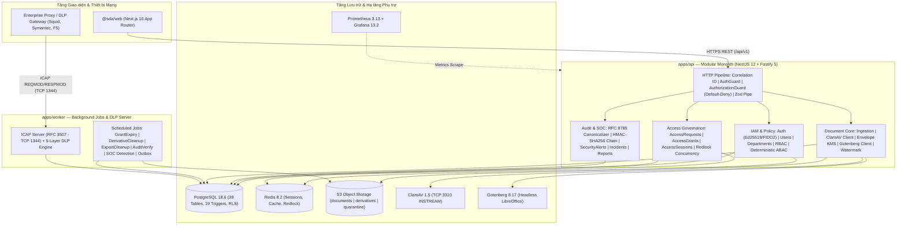
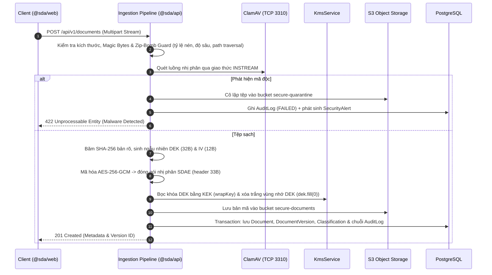

# Secure Document Access System (SDA)

Nền tảng quản trị, lưu trữ mã hóa và kiểm soát truy cập tài liệu mật theo kiến trúc **Zero Trust**, kết hợp phân quyền **RBAC + Deterministic ABAC**, mô hình đa mức **Bell-LaPadula**, mã hóa phong bì **AES-256-GCM**, thủy ấn pháp chứng động (**Forensic Watermarking**), chuỗi nhật ký bất biến **RFC 8785 + HMAC-SHA256** và cổng chống thất thoát dữ liệu tầng mạng **ICAP Server (RFC 3507)**.

---

## Mục lục

1. [Tổng quan Công nghệ (Tech Stack)](#1-tổng-quan-công-nghệ-tech-stack)
2. [Kiến trúc Hệ thống & Monorepo](#2-kiến-trúc-hệ-thống--monorepo)
3. [Luồng Xử lý Dữ liệu Trọng yếu](#3-luồng-xử-lý-dữ-liệu-trọng-yếu)
4. [Đặc tả Cơ chế Bảo mật & Mật mã học](#4-đặc-tả-cơ-chế-bảo-mật--mật-mã-học)
5. [Mô hình Phân quyền, Phân loại Mật & Cơ sở dữ liệu](#5-mô-hình-phân-quyền-phân-loại-mật--cơ-sở-dữ-liệu)
6. [Cài đặt & Vận hành Môi trường Phát triển](#6-cài-đặt--vận-hành-môi-trường-phát-triển)
7. [Tham chiếu Biến Môi trường](#7-tham-chiếu-biến-môi-trường)
8. [Kiểm thử, Cổng Chất lượng & DevSecOps](#8-kiểm-thử-cổng-chất-lượng--devsecops)
9. [Triển khai Production & Cloud](#9-triển-khai-production--cloud)
10. [Tài liệu Tham khảo Nội bộ](#10-tài-liệu-tham-khảo-nội-bộ)

---

## 1. Tổng quan Công nghệ (Tech Stack)

| Phân tầng               | Công nghệ & Phiên bản                                                                                      | Vai trò Kỹ thuật                                                                                     |
| :---------------------- | :--------------------------------------------------------------------------------------------------------- | :--------------------------------------------------------------------------------------------------- |
| **Runtime & Build**     | Node.js `>=24.14.0 <25` (ESM), TypeScript `7.0`, `pnpm@12.4.1`, Turborepo `2.10`                           | Quản lý workspace monorepo, kiểm tra kiểu dữ liệu nghiêm ngặt, điều phối build theo đồ thị phụ thuộc |
| **Backend API**         | NestJS `12.3`, Fastify `5.12`, Zod `4.6`, Swagger / OpenAPI                                                | Modular Monolith REST API (`/api/v1`), validation đầu vào nghiêm ngặt, Policy Decision/Enforcement   |
| **Frontend Web**        | Next.js `16.4` (App Router), React `19.3`, Tailwind CSS `4.3`, `lucide-react`                              | 5 không gian làm việc biệt lập theo vai trò, trình dựng chính sách ABAC (DNF AST), xem tài liệu      |
| **Background & DLP**    | Node.js Worker (`@sda/worker`), Native TCP Server (`RFC 3507`)                                             | 6 tiến trình nền định kỳ + máy chủ ICAP Network DLP lắng nghe cổng TCP `1344`                        |
| **Cơ sở dữ liệu**       | PostgreSQL `18.6`, Prisma ORM `7.10` (`@prisma/adapter-pg`), PGlite `0.5` (WASM)                           | Lưu trữ quan hệ (39 bảng nghiệp vụ), giao dịch `SERIALIZABLE`, trigger bất biến, kiểm thử cô lập     |
| **Bộ nhớ đệm & Khóa**   | Redis `8.2`, `ioredis` `6.0`, Custom Redlock + Lua Scripts                                                 | Lưu trữ phiên, bộ đệm quyền/chính sách, giới hạn tần suất (Rate Limit), khóa phân tán Quorum         |
| **Lưu trữ & Xử lý Tệp** | S3 Object Storage (MinIO / Cloudflare R2 / Supabase S3), ClamAV `1.5`, Gotenberg `8.17`, `pdf-lib`         | Lưu trữ đối tượng mã hóa, quét mã độc luồng TCP `INSTREAM`, chuyển đổi Office sang PDF, đóng dấu     |
| **Mật mã & Xác thực**   | `node:crypto` (`AES-256-GCM`, `HKDF-SHA256`), `jose` (`EdDSA`/`Ed25519`), `argon2`, `@simplewebauthn` `14` | Mã hóa phong bì tài liệu, ký JWT bất đối xứng, băm mật khẩu Argon2id, xác thực TOTP & FIDO2          |
| **Quan sát & Kiểm thử** | Prometheus `3.13`, Grafana `13.2`, Node Test Runner, Playwright `1.63`, Oxlint `1.82`                      | Thu thập metrics, cảnh báo vận hành, kiểm thử Unit / Integration / Infra / E2E                       |

---

## 2. Kiến trúc Hệ thống & Monorepo

Hệ thống được thiết kế theo kiến trúc **Modular Monolith** cho đường đi đồng bộ độ trễ thấp (`@sda/api`) kết hợp tiến trình **Asynchronous Worker & Network DLP Daemon** độc lập (`@sda/worker`).



### Cấu trúc Không gian Làm việc (Workspace Topology)

```text
secure-document-access-system/
├── apps/
│   ├── api/                 # @sda/api — Backend REST API (16 domain modules, Fastify adapter)
│   ├── web/                 # @sda/web — Giao diện người dùng Next.js 16 (5 role workspaces)
│   └── worker/              # @sda/worker — 6 background jobs định kỳ & máy chủ ICAP DLP (TCP 1344)
├── packages/
│   ├── config/              # @sda/config — Cấu hình tsconfig nền tảng dùng chung
│   ├── contracts/           # @sda/contracts — DTOs, Zod schemas, mã lỗi chuẩn hóa, hằng số phân quyền
│   ├── database/            # @sda/database — Prisma 7 schema, 9 migrations (kèm rollback), PG client
│   ├── security/            # @sda/security — Chính sách public endpoint và tiện ích bảo mật cốt lõi
│   └── testing/             # @sda/testing — Khung kiểm thử tích hợp, fixtures và PGlite helpers
├── infra/                   # Cấu hình Docker Compose (local & hardened prod), Prometheus, Grafana
├── supabase/                # Kịch bản SQL đồng bộ toàn phần cho Supabase PostgreSQL (RLS + Seed)
├── e2e/                     # Kịch bản kiểm thử đầu-cuối (Playwright Chromium)
├── test/                    # Kiểm thử đơn vị cấp kho lưu trữ và kiểm thử sẵn sàng hạ tầng (ClamAV, S3)
└── scripts/                 # Công cụ CLI vận hành: sinh khóa mật mã, quản lý infra, sao lưu, kiểm định DB
```

### Danh mục Module trong `@sda/api`

Backend được phân tách thành 16 module nghiệp vụ độc lập tại `apps/api/src/modules/`:

- **Định danh & Truy cập**: `auth`, `users`, `departments`, `rbac`, `abac`
- **Quản trị Vòng đời Tài liệu**: `documents`, `classifications`, `watermarks`
- **Điều phối Quyền Truy cập**: `access-requests`, `access-grants`, `access-sessions`, `concurrency`
- **Kiểm toán, SOC & Vận hành**: `audit`, `security-operations`, `reports`, `notifications`, `system-health`

---

## 3. Luồng Xử lý Dữ liệu Trọng yếu

### 3.1. Pipeline Tiếp nhận & Mã hóa Tài liệu (`DocumentIngestionService`)



### 3.2. Pipeline Đánh giá Chính sách & Phân phối Tài liệu (`DocumentDeliveryService`)

1. **Chặn tại Policy Enforcement Point (`DocumentPepService`)**: Xác thực phiên JWT + kiểm tra trạng thái thu hồi tức thì trên Redis/DB.
2. **Đánh giá Quyền Đa tầng**:
   - Kiểm tra quyền RBAC nền tảng (`DOCUMENT_VIEW` hoặc `DOCUMENT_DOWNLOAD`) và đối chiếu hiệu lực `AccessGrant`.
   - Kiểm tra bất biến **Bell-LaPadula**: `subject.clearance_rank >= document.classification_rank`.
   - Thực thi **Deterministic ABAC Engine**: Biên dịch cây điều kiện DNF trên 15 thuộc tính (Subject, Resource, Environment) theo thuật toán kết hợp **Deny-Overrides** và trích xuất tập **Obligations** (`require_mfa`, `require_watermark`, `forbid_download`, `no_cache`, `max_session_minutes`).
3. **Giải mã & Biến đổi Phái sinh**:
   - Giải bọc DEK qua `KmsService`, xác thực thẻ `GCM Auth Tag` (128-bit) và kiểm tra đối chiếu `SHA-256` bản rõ.
   - Nếu là tệp Office (`.docx`, `.xlsx`, `.pptx`), chuyển tiếp an toàn qua container **Gotenberg** (LibreOffice headless) để kết xuất sang PDF chuẩn hóa.
4. **Đóng dấu Pháp chứng (`WatermarkEngineService`)**:
   - Nhúng trực tiếp lớp văn bản chéo và mã QR chứa danh tính người đọc, địa chỉ IP, dấu thời gian UTC và mã định danh thủy ấn `WM-<hex>` vào từng trang PDF; lưu bản ghi `WatermarkInstance` phục vụ điều tra rò rỉ.
   - Lưu tạm bản phái sinh vào `secure-derivatives` (tự động thu dọn theo `DERIVATIVE_TTL_MINUTES`) hoặc cấp vé tải ngắn hạn (`DOWNLOAD_TICKET_TTL_SECONDS`).

---

## 4. Đặc tả Cơ chế Bảo mật & Mật mã học

### 4.1. Xác thực, Phiên & Đa yếu tố (Authentication & MFA)

- **Mật khẩu (`PasswordService`)**: Chuẩn hóa chuỗi `NFKC`, bắt buộc độ dài `15..128` ký tự, chặn danh sách mật khẩu phổ biến và chặn chứa định danh tài khoản. Băm bằng **Argon2id** (`memoryCost = 65536 KiB`, `timeCost = 3`, `parallelism = 1`, `hashLength = 32`).
- **Ký Token Bất đối xứng (`TokenService`)**: Sử dụng thuật toán **EdDSA (`Ed25519`)** qua thư viện `jose` với thời gian sống ngắn (`AUTH_ACCESS_TTL_SECONDS = 300s`), hỗ trợ đa khóa công khai theo `kid` (`AUTH_SIGNING_PUBLIC_KEYS_JSON`) để xoay vòng khóa không gián đoạn. Refresh Token dạng opaque được băm lưu DB và xoay vòng mỗi lần cấp mới.
- **Bảo vệ Bề mặt Web**: Bảo vệ chống giả mạo yêu cầu liên trang (`CsrfService`), giới hạn tốc độ đăng nhập theo IP/tài khoản (`LoginRateLimitService`), khóa tạm thời khi đăng nhập sai liên tiếp.
- **MFA Chống Lừa đảo (`MfaService` & `WebauthnService`)**:
  - Hỗ trợ `TOTP` (`RFC 6238`), mã khôi phục dùng một lần (`Recovery Codes`), và khóa phần cứng / Passkeys chuẩn **FIDO2 / WebAuthn** (`@simplewebauthn/server`).
  - Đối chiếu bộ đếm chữ ký (`Authenticator Counter`) để phát hiện nhân bản khóa vật lý (Clone Detection) và tự động kích hoạt cảnh báo SOC mức `CRITICAL`.
  - Bắt buộc kích hoạt MFA đối với các vai trò đặc quyền (`SYSTEM_ADMIN`, `SECURITY_OFFICER`, `AUDITOR`).

### 4.2. Định dạng Mã hóa Phong bì (`SDAE` Binary Format) & KMS

Mỗi phiên bản tài liệu (`DocumentVersion`) được mã hóa bằng một khóa `DEK` 256-bit ngẫu nhiên độc lập. Cấu trúc nhị phân tệp mã hóa lưu trên S3:

```text
+-------------------+-------------------+-------------------+-------------------+------------------------+
| Magic 'SDAE' (4B) | Format Ver (1B)   | Nonce / IV (12B)  | GCM Auth Tag (16B)| Ciphertext (Variable)  |
| 0x53 0x44 0x41 45 | 0x01              | 96-bit CSPRNG     | 128-bit MAC       | AES-256-GCM Encrypted  |
+-------------------+-------------------+-------------------+-------------------+------------------------+
|<------------------------------------ 33-Byte Header ------------------------------------>|
```

Khóa `DEK` sau khi mã hóa tệp được bọc bởi `KmsService` và xóa khỏi bộ nhớ (`dek.fill(0)`). Hệ thống định nghĩa giao diện đa nhà cung cấp qua biến `KMS_PROVIDER`:

| Giá trị `KMS_PROVIDER` | Cơ chế Bọc Khóa (Key Wrapping)                                                            | Trạng thái Hỗ trợ Production (`EnvSchema`)  |
| :--------------------- | :---------------------------------------------------------------------------------------- | :------------------------------------------ |
| `local`                | Dẫn xuất `KEK` 256-bit bằng `HKDF-SHA256` (`RFC 5869`), bọc `DEK` qua `AES-256-GCM` (60B) | Cho phép (yêu cầu khóa chủ quản lý ngoài)   |
| `vault`                | Ủy thác bọc/mở khóa qua API **HashiCorp Vault Transit Secrets Engine**                    | Cho phép (yêu cầu `VAULT_TOKEN` thực)       |
| `hsm-pkcs11`           | Adapter mô phỏng chuẩn OASIS PKCS#11 (`CKM_AES_KEY_WRAP`) phục vụ kiểm thử tích hợp       | Bị chặn fail-fast khi `NODE_ENV=production` |
| `aws-kms`              | Adapter mô phỏng giao thức AWS KMS phục vụ kiểm thử định tuyến đa khóa (`rotateKeyRef`)   | Bị chặn fail-fast khi `NODE_ENV=production` |

### 4.3. Kiểm soát Tranh chấp Hai tầng (Two-Tier Concurrency Control)

- **Tầng Phân tán (`RedlockService`)**: Triển khai khóa phân tán trên cụm Redis độc lập với ngưỡng đồng thuận $Q = \lfloor N/2 \rfloor + 1$, bù trừ độ trễ đồng hồ (clock drift), giải phóng/gia hạn nguyên tử bằng Lua script kiểm tra định danh chủ sở hữu khóa, hỗ trợ chế độ `REDLOCK_FAIL_CLOSED`.
- **Tầng Cơ sở dữ liệu**: Sử dụng giao dịch mức cô lập `SERIALIZABLE` (`withSerializableTransaction`) và khóa bi quan cấp dòng `SELECT ... FOR UPDATE` khi cấp phát số hiệu phiên bản tài liệu (`version_no`), xét duyệt yêu cầu truy cập và nối chuỗi băm kiểm toán.

### 4.4. Nhật ký Kiểm toán Chuỗi Băm Bất biến (Tamper-Evident Audit Chain)

- Dữ liệu sự kiện được lọc bỏ thông tin nhạy cảm (`AuditRedactionService`) và chuẩn hóa tất định theo **RFC 8785 (JSON Canonicalization Scheme)** trước khi tính toán mã xác thực.
- Mỗi bản ghi `audit_logs` lưu `chain_sequence` tăng đơn điệu và `entry_hash = HMAC-SHA256(K_audit, prev_hash || canonical_payload)`.
- Hai trigger cấp PostgreSQL (`trg_audit_no_update`, `trg_audit_no_delete`) từ chối mọi câu lệnh `UPDATE` và `DELETE` trực tiếp trên bảng `audit_logs`.
- Tiến trình nền `audit-verification-job` định kỳ đối chiếu lại toàn bộ chuỗi băm với bảng mỏ neo `audit_anchors` để phát hiện can thiệp trái phép ở tầng vật lý.

### 4.5. Chống Thất thoát Dữ liệu Tầng mạng (Network DLP via ICAP RFC 3507)

`@sda/worker` tích hợp máy chủ **ICAP (`RFC 3507`)** thuần Node.js trên cổng TCP `1344`, hỗ trợ các phương thức `OPTIONS`, `REQMOD`, `RESPMOD` và cơ chế `Preview` / `204 No Modifications` để giảm thiểu độ trễ mạng. Động cơ `DlpEngine` quét 5 nhóm dấu hiệu rò rỉ:

1. Nhãn phân loại mật của tổ chức (`TOP_SECRET`, `TUYỆT MẬT`, `TỐI MẬT`, ...).
2. Mã định danh thủy ấn pháp chứng SDA xuất hiện trong luồng tải lên ra ngoài (`WM-[a-f0-9]{48}`).
3. Khóa bí mật định dạng PEM, AWS Access Key, GitHub Personal Access Token.
4. Số thẻ thanh toán quốc tế hợp lệ theo kiểm tra tổng **Luhn Checksum**.
5. Số định danh cá nhân / CCCD 12 chữ số và danh sách từ khóa tùy chỉnh (`ICAP_DLP_CUSTOM_KEYWORDS`).

Khi phát hiện vi phạm ở chế độ `BLOCK`, máy chủ trả về gói tin `ICAP/1.0 200 OK` đóng gói phản hồi `HTTP/1.1 403 Forbidden` và ghi nhận cảnh báo `SecurityAlert` vào PostgreSQL.

---

## 5. Mô hình Phân quyền, Phân loại Mật & Cơ sở dữ liệu

### 5.1. Ma trận 5 Vai trò Hệ thống & Phân tách Trách nhiệm (SoD)

Hệ thống khởi tạo **5 vai trò hệ thống** ánh xạ tới **32 mã quyền nguyên tử (`Permission`)**, tuân thủ nghiêm ngặt nguyên tắc **Default-Deny** và **Separation of Duties (SoD)**:

| Mã Vai trò         | MFA Bắt buộc | Quyền hạn Nghiệp vụ Chính                                                                                         | Ràng buộc Phân tách Trách nhiệm (SoD)                                                          |
| :----------------- | :----------: | :---------------------------------------------------------------------------------------------------------------- | :--------------------------------------------------------------------------------------------- |
| `SYSTEM_ADMIN`     |      Có      | Quản lý người dùng, phòng ban, vai trò RBAC, định nghĩa thuộc tính/chính sách ABAC, cấu hình mẫu watermark        | **Không có** quyền `DOCUMENT_VIEW` và `DOCUMENT_DOWNLOAD`; không thể đọc nội dung tài liệu mật |
| `SECURITY_OFFICER` |      Có      | Giám sát & xử lý `SecurityAlert`, quản lý `IncidentReport`, truy vết thủy ấn (`WATERMARK_TRACE`), ngắt phiên      | Không sở hữu tài liệu nghiệp vụ, không quản trị danh mục tài khoản người dùng                  |
| `AUDITOR`          |      Có      | Xem/xuất nhật ký kiểm toán (`AUDIT_VIEW`, `AUDIT_EXPORT`), truy vết thủy ấn, xuất báo cáo tuân thủ hệ thống       | Quyền chỉ đọc độc lập (Read-Only); không thể sửa đổi chính sách, quyền hạn hay xử lý sự cố     |
| `DOCUMENT_OWNER`   |  Theo ABAC   | Tải lên, phân loại mật, tạo phiên bản mới, lưu trữ tài liệu, phê duyệt `AccessRequest`, cấp/thu hồi `AccessGrant` | Chỉ thao tác trên tài liệu thuộc phạm vi sở hữu/ủy quyền; không truy cập cấu hình hệ thống     |
| `DOCUMENT_READER`  |  Theo ABAC   | Tìm kiếm danh mục khám phá (`DOCUMENT_DISCOVER`), tạo yêu cầu xin quyền, xem/tải tài liệu khi có Grant hợp lệ     | Bị chặn mặc định với mọi nội dung tệp chưa được cấp quyền và vượt quá cấp độ thẩm tra          |

### 5.2. Cấp độ Phân loại Mật (Classification Levels)

Lược đồ cơ sở dữ liệu khởi tạo chuẩn **4 cấp độ phân loại mật** đang hoạt động (cùng hằng số mở rộng `UNCLASSIFIED` trong `@sda/contracts`):

| Mã Phân loại   | Tên Hiển thị | Hạng (`rank`) | Cho phép Tải về (`allow_download`) | Yêu cầu Thủy ấn (`require_watermark`) | Cơ chế Kiểm soát Thực thi                                                                |
| :------------- | :----------- | :-----------: | :--------------------------------: | :-----------------------------------: | :--------------------------------------------------------------------------------------- |
| `INTERNAL`     | Nội bộ       |       1       |              Cho phép              |               Bắt buộc                | Yêu cầu `CLEARANCE_LEVEL >= 1` và chính sách/quyền hợp lệ                                |
| `CONFIDENTIAL` | Mật          |       2       |              Cho phép              |               Bắt buộc                | Yêu cầu `CLEARANCE_LEVEL >= 2`, xét duyệt từ chủ sở hữu tài liệu                         |
| `SECRET`       | Tối mật      |       3       |             **Bị cấm**             |               Bắt buộc                | Chỉ cho phép xem bản phái sinh gắn thủy ấn trong trình duyệt; chặn hoàn toàn tải tệp gốc |
| `TOP_SECRET`   | Tuyệt mật    |       4       |             **Bị cấm**             |               Bắt buộc                | Yêu cầu `CLEARANCE_LEVEL = 4`, xác thực MFA, mạng tin cậy (`ABAC_TRUSTED_NETWORK_CIDRS`) |

### 5.3. Kiến trúc Cơ sở dữ liệu (`@sda/database`)

Lược đồ vật lý trên PostgreSQL được quản lý qua **9 bản Prisma Migration** (có kèm kịch bản `rollback.sql`), bao gồm:

- **39 bảng nghiệp vụ** (31 bảng nền tảng từ migration đầu tiên + 8 bảng mở rộng cho phiên xác thực cứng, FIDO2/MFA, mỏ neo kiểm toán, hộp thư đi, quy tắc phát hiện SOC và xuất báo cáo bất đồng bộ).
- **18 kiểu `ENUM`** định kiểu chặt trạng thái vòng đời thực thể.
- **9 hàm PL/pgSQL** (khóa cứng `search_path`) và **19 Trigger** thực thi bất biến dữ liệu trực tiếp ở tầng lưu trữ:
  - Chặn cập nhật/xóa nhật ký kiểm toán (`trg_audit_no_update`, `trg_audit_no_delete`).
  - Ràng buộc tính hợp lệ của phiên bản hiện hành (`trg_validate_current_document_version` kết hợp khóa ngoại vòng `fk_documents_current_version`).
  - Ràng buộc cấp độ thẩm tra của người dùng trước khi chèn `access_grants` (`trg_validate_user_clearance_for_grant`).
  - Chỉ mục duy nhất từng phần (`uq_document_current_classification`) đảm bảo mỗi tài liệu chỉ có duy nhất một phân loại mật đang có hiệu lực (`effective_to IS NULL`).
- **Row Level Security (RLS)**: Toàn bộ 39 bảng nghiệp vụ và `_prisma_migrations` được kích hoạt RLS chặn truy cập trực tiếp từ vai trò công khai khi triển khai trên hạ tầng Supabase.

---

## 6. Cài đặt & Vận hành Môi trường Phát triển

### 6.1. Yêu cầu Tiên quyết (Prerequisites)

- **Node.js**: `>= 24.14.0 < 25` (được kiểm tra tự động qua `scripts/check-toolchain.mjs` ở bước `preinstall`).
- **Package Manager**: `pnpm@12.4.1` (khuyến nghị kích hoạt qua `corepack enable`).
- **Container Runtime**: Docker Engine & Docker Compose v2 (tối thiểu 4 GB RAM khả dụng cho cụm hạ tầng đầy đủ gồm ClamAV và Gotenberg).

### 6.2. Khởi tạo Nhanh (Step-by-Step)

```bash
# 1. Cài đặt toàn bộ gói phụ thuộc trong monorepo
pnpm install

# 2. Sinh tệp khóa mật mã và thông tin xác thực phát triển cục bộ (.local/dev.env)
pnpm generate-dev-secrets

# 3. Khởi động cụm dịch vụ hạ tầng Docker và kiểm tra tình trạng sẵn sàng
pnpm infra:up
pnpm infra:doctor

# 4. Thực thi 9 bản migration PostgreSQL và nạp dữ liệu nền tảng (RBAC, ABAC, Classifications)
pnpm db:migrate
pnpm db:seed

# 5. Biên dịch các gói phụ thuộc và khởi chạy đồng thời API, Web, Worker ở chế độ watch
pnpm dev
```

> **Lưu ý về Quản lý Bí mật Cục bộ**: Lệnh `pnpm generate-dev-secrets` sinh khóa ngẫu nhiên an toàn mật mã vào tệp `.local/dev.env` (quyền `0600`, đã được `.gitignore`, tách biệt với tệp mẫu `.env.example`). Để xoay vòng lại toàn bộ bí mật cục bộ, chạy `node scripts/generate-dev-secrets.mjs --force`.

### 6.3. Bảng Ánh xạ Cổng Dịch vụ Cục bộ (Service Port Matrix)

Toàn bộ cổng hạ tầng trong `infra/compose.yaml` chỉ gắn vào giao diện loopback `127.0.0.1`:

| Dịch vụ                       | Địa chỉ / Endpoint Cục bộ                  | Mô tả Kỹ thuật                                                     |
| :---------------------------- | :----------------------------------------- | :----------------------------------------------------------------- |
| **Web Application**           | `http://127.0.0.1:3000`                    | Giao diện người dùng Next.js 16                                    |
| **Backend REST API**          | `http://127.0.0.1:3001/api/v1`             | Cổng giao tiếp chính của NestJS + Fastify                          |
| **OpenAPI / Swagger UI**      | `http://127.0.0.1:3001/api/docs`           | Tài liệu đặc tả giao diện lập trình tự động                        |
| **Health & Readiness Probes** | `http://127.0.0.1:3001/api/v1/health/live` | Điểm kiểm tra trạng thái sống/sẵn sàng của API                     |
| **Worker ICAP DLP Server**    | `icap://127.0.0.1:1344`                    | Máy chủ phân tích lưu lượng mạng DLP chuẩn RFC 3507                |
| **PostgreSQL 18.6**           | `127.0.0.1:5432`                           | Cơ sở dữ liệu chính (xác thực `scram-sha-256`)                     |
| **Redis 8.2**                 | `127.0.0.1:6379`                           | Lưu trữ phiên, bộ đệm và khóa phân tán Redlock (AOF `everysec`)    |
| **MinIO S3 API / Console**    | `http://127.0.0.1:9000` / `:9001`          | Lưu trữ đối tượng S3 cục bộ (3 bucket private bật sẵn versioning)  |
| **ClamAV Daemon**             | `127.0.0.1:3310`                           | Máy chủ quét mã độc luồng TCP `clamd`                              |
| **Gotenberg 8.17**            | `http://127.0.0.1:3003`                    | Dịch vụ chuyển đổi tài liệu văn phòng sang PDF cô lập              |
| **Mailpit SMTP / Web UI**     | `127.0.0.1:1025` / `http://127.0.0.1:8025` | Hộp thư bắt giữ email đặt lại mật khẩu và thông báo khi phát triển |
| **Prometheus / Grafana**      | `http://127.0.0.1:9090` / `:3002`          | Thu thập chỉ số hệ thống và bảng điều khiển giám sát vận hành      |

### 6.4. Kích hoạt Tài khoản Mẫu Dùng thử (Zero-Static-Secret Policy)

Tuân thủ chính sách **không lưu trữ mật khẩu tĩnh trong mã nguồn**, kịch bản `pnpm db:seed` chỉ tạo 5 danh tính mẫu (`admin.demo`, `security.demo`, `auditor.demo`, `owner.demo`, `reader.demo`) khi `NODE_ENV !== 'production'` ở trạng thái khóa `DISABLED` với giá trị băm vô hiệu hóa (`!AUTHENTICATION_NOT_CONFIGURED_DEMO_ACCOUNT!`).

Để kích hoạt tài khoản mẫu phục vụ kiểm thử thủ công ở môi trường local:

1. Sinh chuỗi băm **Argon2id** cho mật khẩu tự chọn (tối thiểu 15 ký tự, không chứa tên tài khoản):

```powershell
$env:DEV_PASS="<MAT_KHAU_TOI_THIEU_15_KY_TU>"; node --input-type=module -e "import argon2 from 'argon2'; console.log(await argon2.hash(process.env.DEV_PASS, { type: argon2.argon2id, memoryCost: 65536, timeCost: 3, parallelism: 1, hashLength: 32 }));"; Remove-Item Env:\DEV_PASS
```

2. Cập nhật `password_hash` và chuyển `status = 'ACTIVE'` cho tài khoản cần dùng trong PostgreSQL (ví dụ `owner.demo`, `reader.demo`). Với 3 tài khoản đặc quyền (`admin.demo`, `security.demo`, `auditor.demo`), sau bước đăng nhập mật khẩu đầu tiên cần hoàn tất đăng ký phương thức MFA (`TOTP` hoặc `FIDO2/WebAuthn`) theo luồng pre-MFA.

---

## 7. Tham chiếu Biến Môi trường

Cấu hình ứng dụng được kiểm tra hợp lệ nghiêm ngặt lúc khởi động thông qua `apps/api/src/config/env.schema.ts` (Zod). Khi `NODE_ENV=production`, hệ thống áp dụng cơ chế **Fail-Fast**: từ chối khởi chạy nếu phát hiện bất kỳ khóa mặc định/placeholder nào hoặc thiếu cặp khóa ký `Ed25519`.

| Nhóm Cấu hình      | Biến Môi trường Tiêu biểu                                                                                    | Mô tả & Quy tắc Ràng buộc                                                                         |
| :----------------- | :----------------------------------------------------------------------------------------------------------- | :------------------------------------------------------------------------------------------------ |
| **Mạng & API**     | `NODE_ENV`, `HOST`, `PORT`, `CORS_ALLOWED_ORIGINS`                                                           | Chế độ vận hành (`development`/`test`/`production`), địa chỉ bind và danh sách origin được phép   |
| **Cơ sở dữ liệu**  | `DATABASE_URL`, `DIRECT_URL`, `DATABASE_POOL_MAX`, `DATABASE_SSL_REJECT_UNAUTHORIZED`                        | Chuỗi kết nối PostgreSQL, kích thước pool và tùy chọn TLS khi kết nối qua Supabase Supavisor      |
| **Redis & Khóa**   | `REDIS_URL`, `REDLOCK_CLUSTER_NODES`, `REDLOCK_DEFAULT_TTL_MS`, `REDLOCK_FAIL_CLOSED`                        | Cấu hình Redis đơn lẻ hoặc cụm nút Redlock độc lập và chính sách đóng/mở khi mất quorum           |
| **Lưu trữ & Tệp**  | `STORAGE_ENDPOINT`, `STORAGE_PORT`, `STORAGE_USE_SSL`, `STORAGE_BUCKET_*`, `CLAMAV_*`, `GOTENBERG_URL`       | Kết nối S3 (`documents`, `derivatives`, `quarantine`), máy chủ quét virus và bộ chuyển đổi Office |
| **Giới hạn Tải**   | `UPLOAD_MAX_FILE_SIZE_BYTES`, `ZIP_MAX_TOTAL_UNCOMPRESSED_SIZE`, `ZIP_MAX_ENTRIES`, `ZIP_MAX_DEPTH`          | Ngưỡng bảo vệ chống tấn công cạn kiệt tài nguyên (DoS / Zip Bomb)                                 |
| **Mật mã & KMS**   | `KMS_PROVIDER`, `APP_ENCRYPTION_MASTER_KEY`, `VAULT_ADDR`, `VAULT_TOKEN`, `VAULT_KEY_NAME`                   | Chọn nhà cung cấp KMS (`local` / `vault`) và khóa gốc tối thiểu 32 ký tự độ entropy cao           |
| **Xác thực & MFA** | `AUTH_SIGNING_PRIVATE_KEY_PEM`, `AUTH_SIGNING_PUBLIC_KEYS_JSON`, `AUTH_ACTIVE_KID`, `WEBAUTHN_RP_ID`         | Cặp khóa ký JWT `Ed25519` (bắt buộc cấu hình ngoài trên Production) và định danh miền WebAuthn    |
| **Kiểm toán**      | `AUDIT_INTEGRITY_KEY`, `DOCUMENT_AUDIT_HMAC_KEY`, `AUTH_AUDIT_HMAC_KEY`, `AUDIT_VERIFY_INTERVAL_MS`          | Khóa bí mật HMAC-SHA256 bảo vệ tính toàn vẹn chuỗi nhật ký và chu kỳ đối soát nền                 |
| **ICAP DLP**       | `ICAP_SERVER_ENABLED`, `ICAP_SERVER_HOST`, `ICAP_SERVER_PORT`, `ICAP_DLP_ACTION`, `ICAP_DLP_CUSTOM_KEYWORDS` | Bật/tắt máy chủ ICAP trên Worker, chế độ xử lý (`BLOCK` / `MONITOR`) và từ khóa nhạy cảm bổ sung  |

Xem danh sách đầy đủ các tham số mặc định tại [`.env.example`](./.env.example) và [`apps/api/src/config/env.schema.ts`](./apps/api/src/config/env.schema.ts).

---

## 8. Kiểm thử, Cổng Chất lượng & DevSecOps

### 8.1. Lệnh Kiểm tra Chất lượng Cục bộ

Toàn bộ thay đổi mã nguồn phải vượt qua lệnh tổng hợp `pnpm check` trước khi hợp nhất:

| Lệnh CLI                | Công cụ Thực thi                        | Phạm vi Xác minh                                                                                 |
| :---------------------- | :-------------------------------------- | :----------------------------------------------------------------------------------------------- |
| `pnpm format:check`     | Prettier `3.9`                          | Kiểm tra chuẩn định dạng mã nguồn, YAML, JSON và Markdown toàn kho                               |
| `pnpm lint`             | Oxlint `1.82` (`--deny-warnings`)       | Phân tích tĩnh tốc độ cao trên toàn bộ `apps/*`, `packages/*`, `scripts`, `test`, `e2e`          |
| `pnpm typecheck`        | TypeScript `7.0` (`--noEmit`)           | Kiểm tra tính đúng đắn kiểu dữ liệu xuyên suốt các gói workspace và schema Prisma                |
| `pnpm test`             | Node.js Test Runner                     | Kiểm thử đơn vị (Unit & Domain logic): ABAC AST, KMS, mã hóa SDAE, chuỗi HMAC, parser ICAP DLP   |
| `pnpm test:integration` | Node.js Test Runner + PostgreSQL/PGlite | Kiểm thử tích hợp migration, rollback, giao dịch `SERIALIZABLE` và luồng API                     |
| `pnpm test:infra`       | `scripts/run-infra-tests.mjs`           | Kiểm thử sẵn sàng hạ tầng thực tế: quét mẫu thử EICAR qua ClamAV, quyền riêng tư bucket S3       |
| `pnpm test:e2e`         | Playwright `1.63` (Chromium)            | Kiểm thử đầu-cuối giao diện người dùng và chu vi bảo vệ route (`AuthGuard`)                      |
| `pnpm db:validate`      | Prisma Validate + PGlite WASM           | Kiểm chứng độc lập lược đồ nền tảng, khóa ngoại vòng, trigger chống sửa xóa nhật ký và clearance |
| `pnpm security:scan`    | `scan-secrets.mjs` + `pnpm audit`       | Quét rò rỉ khóa bí mật trong cây thư mục và lỗ hổng phụ thuộc mức `high`/`critical`              |
| `pnpm check`            | Chuỗi tuần tự toàn bộ cổng trên         | Cổng chất lượng tổng thể bắt buộc trên CI                                                        |

### 8.2. Quản trị Hạ tầng & Tiện ích Vận hành (`scripts/`)

- `pnpm infra:up` / `pnpm infra:down` / `pnpm infra:logs [service]`: Khởi chạy, dừng an toàn (giữ nguyên dữ liệu named volumes) và theo dõi nhật ký container.
- `pnpm infra:reset-safe`: Xóa sạch container và dữ liệu named volumes cục bộ (yêu cầu nhập chuỗi xác nhận chính xác để chống mất dữ liệu nhầm lẫn).
- Các kịch bản chuyên dụng khác trong `scripts/`: `backup-restore.mjs` (sao lưu/phục hồi), `load-test.mjs` (kiểm thử tải), `profile-queries.mjs` (phân tích hiệu năng truy vấn), `smoke-test.mjs`, `check-licenses-sbom.mjs`.

### 8.3. Đường ống CI/CD & Quét An ninh Tự động (`.github/workflows/`)

- **`ci.yml`**: Kiểm tra Dependency Review trên Pull Request, dựng cụm container cô lập, chạy migration/seed và thực thi trọn bộ `pnpm check`.
- **`security.yml`**: Chạy định kỳ hàng tuần và trên mỗi lần đẩy mã với 5 lớp kiểm tra DevSecOps: **CodeQL** (SAST cho JS/TS), **Semgrep** (OWASP Top 10), **Gitleaks** (quét lịch sử Git theo `.github/gitleaks.toml`), **Trivy** (quét lỗ hổng hệ thống tệp & cấu hình sai), và **Syft** (xuất danh mục thành phần phần mềm chuẩn `SPDX JSON SBOM`).
- **`cd.yml`**: Tự động triển khai Prisma migration lên cơ sở dữ liệu đích, đóng gói đa image (`api`, `worker`, `web`) đẩy lên GitHub Container Registry (`ghcr.io`) và ký chứng thực nguồn gốc bản dựng **SLSA Build Provenance Attestation**.

---

## 9. Triển khai Production & Cloud

### 9.1. Cấu hình Container Cứng hóa (`infra/compose.prod.yaml`)

Cụm triển khai sản xuất tuân thủ các nguyên tắc cô lập container nghiêm ngặt:

- **Quyền tối thiểu cấp Hệ điều hành**: Chạy dưới định danh non-root (`10001:10001` cho API/Worker, `1000:1000` cho Web, `1001:1001` cho Gotenberg), thu hồi toàn bộ Linux capabilities (`cap_drop: [ALL]`) và bật cờ `no-new-privileges:true`.
- **Hệ thống tệp Gốc Chỉ đọc (`read_only: true`)**: Vùng ghi tạm thời duy nhất được gắn qua `tmpfs` trên RAM với cờ `noexec,nosuid,nodev`.
- **Cô lập Mạng & Giới hạn Tài nguyên**: Tách biệt mạng truy cập biên (`sda-prod-edge-network`, chỉ mở loopback `127.0.0.1:3000` và `127.0.0.1:3001` sau Reverse Proxy/WAF) với mạng nội bộ hoàn toàn không có đường ra Internet (`sda-prod-isolated-network`, `internal: true`). Áp đặt giới hạn cứng `cpus`, `mem_limit` và `pids_limit` (chống fork bomb) cho từng dịch vụ.

```bash
docker compose --env-file .env.production -f infra/compose.prod.yaml up -d
```

### 9.2. Tích hợp Hạ tầng Đám mây (Managed Cloud Services)

- **Managed PostgreSQL (Supabase / AWS RDS)**: Hệ thống tương thích hoàn toàn với Supabase PostgreSQL (bao gồm tự động xử lý TLS cho Supavisor Session Pooler tại `@sda/database` và kịch bản khóa chặt RLS trọn gói tại [`supabase/01_supabase_full_schema_and_seed.sql`](./supabase/01_supabase_full_schema_and_seed.sql)).
- **S3-Compatible Object Storage**: Thay thế MinIO cục bộ bằng **Cloudflare R2**, **AWS S3** hoặc **Supabase Storage S3** thông qua bộ biến `STORAGE_ENDPOINT`, `STORAGE_REGION`, `STORAGE_USE_SSL=true`.
- **External KMS**: Khuyến nghị cấu hình `KMS_PROVIDER=vault` kết nối cụm **HashiCorp Vault Transit Engine** riêng biệt để tách rời hoàn toàn khóa chủ khỏi bộ nhớ máy chủ ứng dụng.

---

## 10. Tài liệu Tham khảo Nội bộ

- [`supabase/README.md`](./supabase/README.md): Hướng dẫn chi tiết khởi tạo lược đồ 39 bảng, đồng bộ checksum Prisma Migration, kiểm chứng RLS và kích hoạt tài khoản trên Supabase PostgreSQL.
- [`infra/README.md`](./infra/README.md): Quy tắc vận hành hạ tầng Docker Compose cục bộ, cơ chế bảo vệ dữ liệu volume và giám sát Prometheus / Grafana.
- [`rules/ui-design-system.md`](./rules/ui-design-system.md): Quy chuẩn hệ thống thiết kế giao diện người dùng (Typography tiếng Việt, bảng màu trạng thái, biểu tượng và chu vi bảo vệ route Frontend).
- [`.github/workflows/`](./.github/workflows): Định nghĩa đường ống CI, quét bảo mật tự động DevSecOps và phát hành container chuẩn SLSA.
